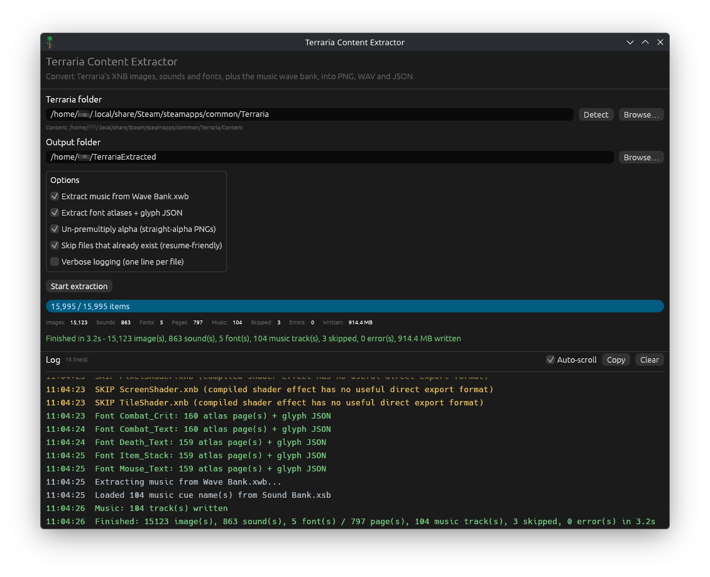

# Terraria Content Extractor

[](https://github.com/tser239/terraria-content-extractor/actions/workflows/ci.yml)
[](https://github.com/tser239/terraria-content-extractor/actions/workflows/release.yml)
[](LICENSE)

Small Rust desktop app that converts the assets shipped in Terraria's `Content`
folder into ordinary files:

| Source | Output |
|---|---|
| `Images/**/*.xnb` | `Images/**/*.png` |
| `Sounds/**/*.xnb` | `Sounds/**/*.wav` (PCM) |
| `Fonts/*.xnb` | `Fonts/<name>_<page>.png` + `Fonts/<name>.json` |
| `Content/Wave Bank.xwb` | `Music/Music_<name>.wav` (MS ADPCM) |

The compiled shaders (`PixelShader.xnb`, `ScreenShader.xnb`, `TileShader.xnb`)
are recognised and skipped, since a compiled effect has no useful direct export
format.

Everything is decoded in pure Rust - no MonoGame runtime, no `xnbcli`, no
`ffmpeg` - using `lzxd` for the LZX-compressed XNB container,
`texture2ddecoder` for the DXT3 font atlases, and `image` for PNG encoding.



## Usage

Ready-to-download builds are on GitHub under
[Releases](https://github.com/tser239/terraria-content-extractor/releases).

1. Start the app (download a release, or run `cargo run --release`).
2. Confirm the auto-detected Terraria folder; use **Detect** or **Browse…** if it
   is wrong or empty.
3. Choose an output folder with **Browse…**.
4. Click **Start extraction** and follow the progress bar and log.

See [GUI](#gui) for the options and [CLI](#cli) for headless use.

## Requirements

- Rust 1.95 or newer (eframe 0.37)
- A desktop session for the GUI (Linux, Windows or macOS)

## Platform support

Linux, Windows and macOS. The extraction code is pure Rust with no
platform-specific APIs; the only conditional code is Steam/GOG path discovery
and the Linux XWayland fallback. The crate compile-checks for
`x86_64-pc-windows-gnu`, `x86_64-apple-darwin` and `aarch64-apple-darwin`.

Things that differ per platform:

- **Folder pickers** use the native dialog on all three.
- **Windows** GUI runs without a console window; `--cli` keeps normal console
  output.
- **macOS** gets a universal `.app` bundle from `scripts/package-macos.sh`.
- **Wayland** - the app starts through XWayland by default; set
  `TCX_NATIVE_WAYLAND=1` to keep the native Wayland backend.

## Build

```sh
cargo build --release
```

The binary is `target/release/terraria-content-extractor`.

### Packaging

Release scripts produce everything under `dist/`, each artifact with a
`SHA256SUMS` file. All builds are 64-bit; macOS is universal.

**Linux** (tarball, `.deb`, AppImage):

```sh
./scripts/package-linux.sh          # builds in Docker (Ubuntu 22.04, glibc 2.35)
./scripts/package-linux.sh --native # quick local build, current glibc only
```

The Docker path needs Docker and network access on the first run (builder image,
crates, pinned `appimagetool`). Outputs:

- `terraria-content-extractor-<version>-x86_64-linux-gnu.tar.gz`
- `terraria-content-extractor_<version>_amd64.deb`
- `Terraria_Content_Extractor-<version>-x86_64.AppImage`

The `.deb` and AppImage integrate with the desktop; the tarball stays portable.
The AppImage may need `libfuse2` on distributions that do not ship FUSE 2.

**Windows** (portable zip):

```powershell
pwsh -File scripts/package-windows.ps1
```

Builds `x86_64-pc-windows-msvc` with a static C runtime, embeds version metadata,
and zips the exe with the docs. Use `-NoStaticCrt` if you prefer the system VC++
runtime.

**macOS** (universal, ad-hoc signed `.app` zip):

```sh
./scripts/package-macos.sh
open "dist/Terraria Content Extractor.app"
```

Builds both `x86_64-apple-darwin` and `aarch64-apple-darwin`, combines them with
`lipo`, writes `Info.plist`, and ad-hoc signs the bundle. Set `BUNDLE_ID=...` to
override the identifier. The zip is signed ad-hoc, so Gatekeeper still asks for a
right-click → Open on first launch; public distribution needs a Developer ID and
notarization.

### Releases

Releases are built by GitHub Actions:

- `.github/workflows/ci.yml` runs formatting, clippy and tests on every push and
  pull request, and performs a packaging dry run on `main` (artifacts kept for
  seven days).
- `.github/workflows/release.yml` runs when a `v*` tag is pushed. It builds all
  three platforms, merges the checksum files into one `SHA256SUMS`, and creates a
  **draft** GitHub release. It fails if the tag does not match the version in
  `Cargo.toml`.

To publish a version:

1. Bump `version` in `Cargo.toml` and commit it.
2. Tag and push:

   ```sh
   git tag -a v0.1.0 -m "v0.1.0"
   git push origin v0.1.0
   ```

3. Review the draft release on GitHub and publish it.

Commit messages follow [Conventional Commits](https://www.conventionalcommits.org/),
for example `fix: handle empty library folders` or `ci: cache appimagetool`.

## GUI

```sh
./target/release/terraria-content-extractor
```

- **Terraria folder** - the game root (`…/common/Terraria`) or its `Content`
  folder; both are accepted. The app searches common Steam/GOG locations at
  startup (including extra Steam library folders) and pre-fills the field when it
  finds an install; use **Detect** to search again, or **Browse…** to pick a
  folder manually. If nothing is found, the field is left empty and the app shows
  a notice saying so instead of silently continuing.
- **Output folder** - no default; pick one with **Browse…** or type/paste a
  path. **Start extraction** stays disabled until it is filled in.
- Each field has a **Browse…** button that opens the operating system's native
  folder picker (XDG desktop portal on Linux). You can also type or paste a path.
- **Start extraction** runs the conversion on a background thread; **Cancel**
  stops it at the next file. The log panel at the bottom is resizable and can be
  copied or cleared, and it auto-scrolls unless you turn that off.

Options:

- **Extract music** - read the music tracks from `Wave Bank.xwb`.
- **Extract font atlases + glyph JSON** - export all font atlas page PNGs and the
  per-font metrics.
- **Un-premultiply alpha** - Terraria's textures are stored premultiplied;
  enabling this (the default) writes straight-alpha PNGs that look correct in
  normal image viewers and editors.
- **Skip files that already exist** - resume-friendly; leave it off to force a
  full rewrite.
- **Verbose logging** - one log line per converted file.

## CLI

A headless mode is available for scripting and verification:

```sh
./target/release/terraria-content-extractor --cli <input> <output> [options]
```

| Option | Effect |
|---|---|
| `--no-music` | skip `Wave Bank.xwb` |
| `--no-fonts` | skip font extraction |
| `--keep-premultiplied` | leave alpha premultiplied |
| `--skip-existing` | do not overwrite existing files |
| `--verbose` | log every file |
| `--quiet` | log only warnings and errors |
| `--jobs N` | worker threads (default: available CPUs) |
| `--version`, `-V` | print the version and exit |

`<input>` may be the Terraria root or the `Content` folder. Exit code is `0` on
success and `1` if any file failed.

Example:

```sh
./target/release/terraria-content-extractor --cli \
  "$HOME/.local/share/Steam/steamapps/common/Terraria" \
  "$HOME/TerrariaExtracted"
```

## Troubleshooting

- **"Terraria was not found automatically"** - the input field starts empty.
  Click **Detect**, or use **Browse…** to select the game root
  (`…/common/Terraria`) or its `Content` folder.
- **Linux: no folder picker opens** - the native dialog needs
  `xdg-desktop-portal` and a portal backend, which GNOME and KDE install by
  default.
- **Linux/Wayland: the window behaves unusually** - the app runs through
  XWayland by default. Set `TCX_NATIVE_WAYLAND=1` to use the native Wayland
  backend instead.
- **AppImage does not start** - some distributions ship without FUSE 2. Install
  `libfuse2`, or run it with
  `APPIMAGE_EXTRACT_AND_RUN=1 ./Terraria_Content_Extractor-*.AppImage`.
- **macOS: "app is damaged" or Gatekeeper blocks it** - the bundle is ad-hoc
  signed, not notarized. Right-click the app and choose **Open**, or clear the
  quarantine flag:
  `xattr -dr com.apple.quarantine "Terraria Content Extractor.app"`.
- **Windows: SmartScreen warning** - the executable is unsigned. Choose
  **More info → Run anyway** if you trust the download.
- **Some files are skipped** - the three compiled shaders have no export format
  and are reported as skipped; this is expected.

## Output details

### Images

Every texture is written with the same relative path as its XNB, converted to
`.png`. All 15,123 retail images are `SurfaceFormat.Color` (RGBA8); DXT1/DXT3/DXT5
are also handled in case a mod uses them.

### Sounds

The 863 `SoundEffect` assets contain a `WAVEFORMATEX` block plus PCM samples.
The WAV writer reuses that block verbatim, so mono/stereo and sample rates are
preserved.

### Fonts

Each of the 5 `DynamicSpriteFont` assets holds a set of DXT3 atlas pages
(797 pages total). Pages are written as PNG; the JSON document contains:

```json
{
  "name": "Death_Text",
  "spacing": 0.0,
  "line_spacing": 72,
  "default_character": "*",
  "pages": [
    {
      "page": 0,
      "texture": "Death_Text_0.png",
      "width": 1024,
      "height": 1024,
      "glyphs": [
        {
          "character": "A",
          "codepoint": 65,
          "glyph": [x, y, width, height],
          "cropping": [x, y, width, height],
          "kerning": [x, y, z]
        }
      ]
    }
  ]
}
```

### Music

`Wave Bank.xwb` is a XACT v46 bank of stereo MS ADPCM tracks. Each track is
written as a WAV with the required `fmt` (coefficient table), `fact` (sample
count) and `data` chunks, which keeps it fully self-contained and playable
without ffmpeg. Names come from the simple cues in `Sound Bank.xsb` (for example
`Music_1`, `Music_2`, …); if the sound bank cannot be read, generic
`Music_001`-style names are used.

Note that the game stores these tracks as ADPCM, so exporting them cannot
recover information that was already lost during compression.

## Verified against

Terraria `Content` folder (Steam, Linux), 755 MB of inputs:

```
15123 images
  863 sounds
    5 fonts / 797 pages
  104 music tracks
    3 skipped shaders
    0 errors
```

A full run takes a few seconds on a modern machine and produces roughly 1 GB.

## Notes

- Only use this with assets you are legally entitled to extract. The extractor
  reads from the selected input folder and never modifies it.
